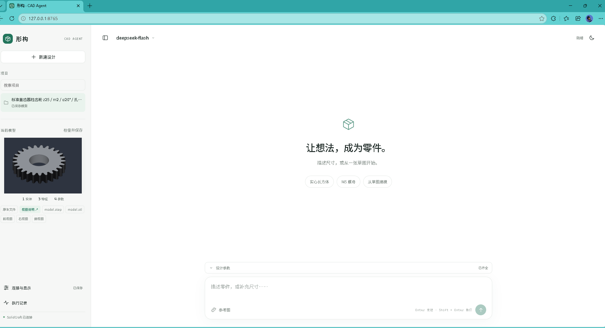
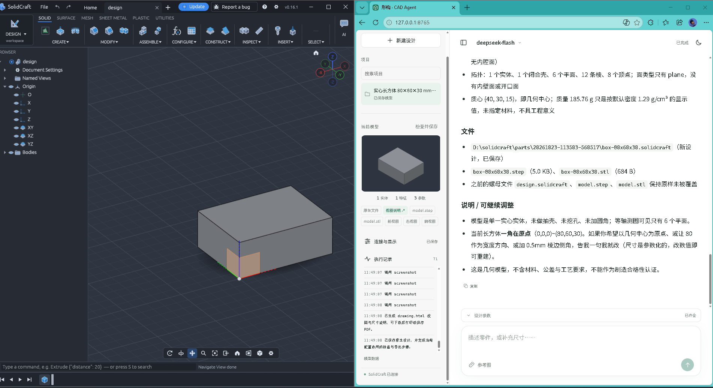
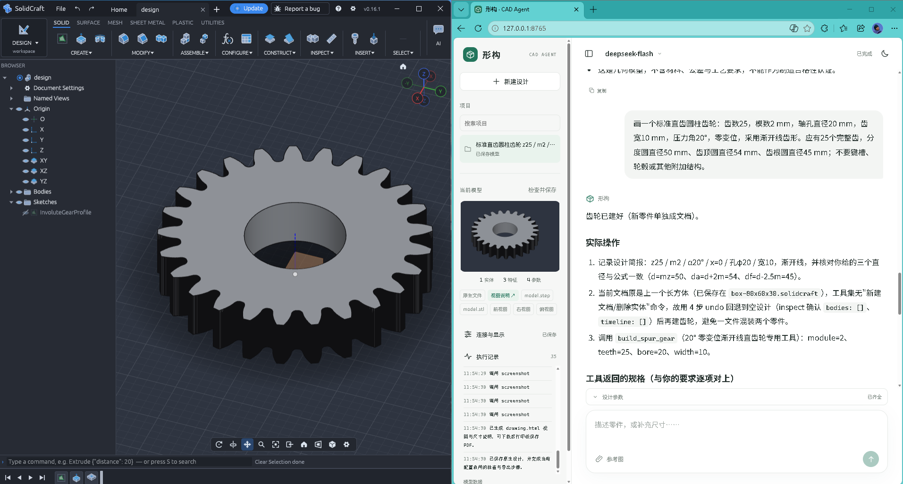
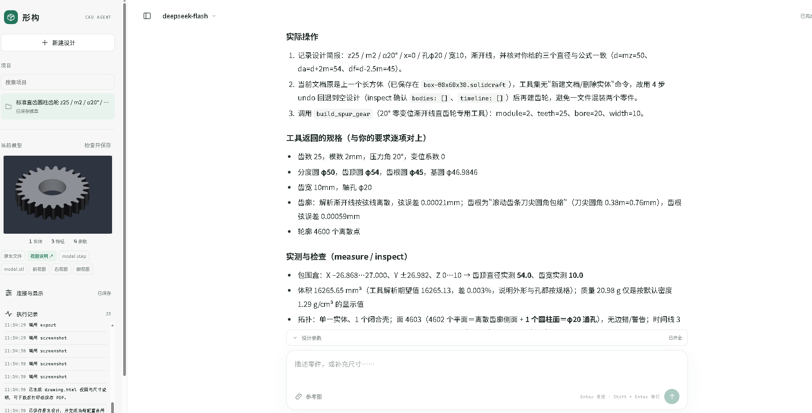

# CAD Agent · 形构

通过文字、实物照片或草图描述零件，整理结构和尺寸，补齐关键参数后调用 SolidCraft 建模、保存和出图。

项目采用 Python、FastAPI 与原生 HTML/CSS/JavaScript，网页运行在本机，不需要 Node.js 构建。模型通过 API 处理需求，CAD 几何运算在本机执行。

## 功能

- 文字尺寸描述，图片上传、粘贴和拖放。
- 结构化提取参数，区分用户描述、图片标注、标准规格、推导值与待确认尺寸。
- 缺失关键参数时通过对话补齐，齐全后自动建模。
- SolidCraft 桌面可见操作，或独立会话执行。
- 原生设计、STEP/STL、等轴测和三视图、可打印尺寸说明。
- 项目列表与搜索、模型预览、图片放大、表格与代码块、答复复制。
- 字体、字号、浅色/深色主题和可折叠项目栏。
- 多模型配置、终端入口和可嵌入的 Python 任务接口。

已有参数化配方包括实心长方体、开口盒、M5 螺母和标准直齿轮。生成的是几何模型；当前出图为模型视图与参数说明，尚未实现完整制造工程图的尺寸线、公差及技术要求。

## 快速开始

当前支持环境：Windows 10/11、Python 3.11/3.12、支持 MCP 的 SolidCraft CLI；桌面可见模式还需同一版本的 SolidCraft 桌面程序。本机凭证加密使用 Windows DPAPI，其他平台尚未验证。

SolidCraft 是外部运行依赖，需自行准备与本项目工具协议兼容的程序。本仓库不包含 CAD 可执行程序、模型服务或 API 配额。

克隆仓库并安装依赖：

~~~powershell
git clone https://github.com/sks-curry/cadagent.git
cd cadagent
python -m venv .venv
.\.venv\Scripts\python.exe -m pip install -r requirements.txt
~~~

按自己的安装位置设置环境并启动：

~~~powershell
$env:SOLIDCRAFT_CLI = "C:\Tools\SolidCraft\solidcraft-cli.exe"
$env:SOLIDCRAFT_PARTS = "C:\CADProjects"
$env:DEEPSEEK_API_KEY = "Xx"
.\.venv\Scripts\python.exe -X utf8 app.py
~~~

`Xx` 是密钥占位符，运行前在本机替换。也可以不设置密钥环境变量，启动后在左侧“连接与显示”输入自己的 Key。启用“加密保存到本机”后，连接配置由当前 Windows 账户的 DPAPI 保存。

打开 [本机界面](http://127.0.0.1:8765)。后续可双击 `start.cmd` 启动；需要重启时运行 `powershell -ExecutionPolicy Bypass -File restart.ps1`。已有任务运行期间，重启脚本会拒绝重启。

桌面模式会在 CLI 同目录查找 `solidcraft.exe`，默认连接 `127.0.0.1:17878`。无桌面需求时设置 `$env:SOLIDCRAFT_VISIBLE = "0"`。若未配置路径，CLI 默认位于仓库上一级的 `solidcraft-cli.exe`，模型输出默认写入上一级 `parts` 目录。

密钥只通过环境变量或本机连接面板配置；项目不会自动读取 `.env` 文件。不要将真实密钥写入 README、提示词或 JSON 配置。

## 使用方式

输入尺寸与结构，或上传参考图；收到问题后直接回复缺失参数。建模完成后，从左侧下载设计与视图。

- 默认 Enter 发送，Shift + Enter 换行；输入法选词时不会发送。
- 支持 PNG、JPEG、WebP；单张最多 8 MB、一次合计 16 MB、每个项目最多 4 张。
- 图片会发送给所选模型识别。没有清晰标注或尺度依据的关键尺寸需要补充。
- “继续任务”处理输出截断等中断；补尺寸直接发送新对话。
- 字体和主题设置仅保存在当前浏览器。

提示词集中保存在 [examples/prompts.md](examples/prompts.md)，包含简单到详细的三轮描述，以及图片识别与补参示例。

## 自定义模型与工作流

复制 [agent.example.json](agent.example.json) 为 `agent.local.json`，按自己的环境修改。相对路径按配置文件目录解析。模型名称、输出预算和图片支持请按服务实际能力填写；示例配置不是通用能力承诺。

| 配置项 | 用途 |
| --- | --- |
| models | 多个模型的名称、API 地址、协议、密钥环境变量 |
| paths | CAD CLI 路径和项目输出目录 |
| cad | 桌面可见模式、连接端口或独立会话 |
| agent.instructions_file | 额外的设计规范、单位及交付要求 |
| agent.max_rounds | 单段执行轮数；0 表示无固定轮数上限 |
| workflow | 测量、导出、预览、阶段保存及出图开关 |

兼容服务需要支持 Chat Completions 工具调用；图文任务还需要图片输入能力。其他服务使用独立密钥环境变量，不会自动复用已保存的 DeepSeek Key。输出预算根据服务实际能力配置。

当前网页连接面板直接配置 DeepSeek；其他兼容服务通过 JSON 配置与终端入口使用。

终端运行：

~~~powershell
Copy-Item agent.example.json agent.local.json
# 编辑 agent.local.json 中的模型、路径和工作流后执行
.\.venv\Scripts\python.exe -X utf8 cli.py profiles --config agent.local.json
.\.venv\Scripts\python.exe -X utf8 cli.py run --config agent.local.json --profile deepseek-fast --prompt "画一个80×60×30的实心长方体" --visible
.\.venv\Scripts\python.exe -X utf8 cli.py run --image "C:\references\sketch.png" --prompt "根据草图补齐尺寸后建模" --visible
~~~

其他兼容服务使用独立环境变量，例如 `$env:CUSTOM_MODEL_API_KEY = "Xx"`，再选择 `--profile custom-compatible`。网页入口目前不会自动加载该 JSON 配置。

终端默认使用独立会话。指定配置时按配置运行，或用 --visible / --headless 覆盖。本地规则验证使用 --local，不调用模型。Python 程序可复用 cli.run_task。

## 界面交互如何实现

~~~text
index.html              页面结构、控件、图标及本次会话标记
static/styles.css       字体、颜色、排版、布局及响应式规则
static/app.js           上传、对话、项目切换、状态轮询与显示偏好
static/markdown.js      表格、代码块、列表与行内格式的 DOM 渲染
app.py                  本机 API 与静态文件服务
~~~

前端提交任务后轮询任务接口，依据真实模型/工具事件显示进度，结束后展示答复和文件。当前没有逐 token 流式答复。连接配置、运行凭证与 CAD 执行由 Python 后端管理。

默认优先使用本机 Noto Sans SC；未安装时回退到系统字体。无需下载在线字体。颜色、字体和内容宽度统一通过 CSS 变量调整；可以更换整套界面而继续复用后端接口。

详细说明见 [界面与自定义](docs/customization.md)。

## 界面展示

## 架构与目录

~~~text
文字 / 图片
    → 结构参数整理与补参
    → 模型选择工具
    → schema、命令和路径校验
    → MCP / SolidCraft
    → 测量、保存、导出和视图
~~~

~~~text
agent.py / app.py / cli.py   智能体、网页 API 和终端入口
index.html / static/        前端结构、样式和交互
recipes.py                  参数化配方
agent.example.json          不含密钥的配置模板
docs/                       架构和扩展说明
examples/                   简单到详细的建模提示词
test_*.py                   可复用的离线测试
.private/                   本机加密配置与运行记录，不上传
~~~

MCP 会话及 CAD 操作由专用协程串行管理。模型规划依据真实状态和工具结果；关键参数未补齐时阻止模型驱动的几何修改。详见 [架构与工作原理](docs/architecture.md)。

## 开发与测试

~~~powershell
.\.venv\Scripts\python.exe -X utf8 -m unittest test_model_limits test_configuration test_vision_workflow test_geometry_verification -v
~~~

这些测试使用模拟模型和临时项目，不调用付费模型或修改桌面设计。测试完成会清除各自临时项目；按需清理空测试目录和 Python 缓存。
## 建模测试
我分别测试画了一个长方体和一个齿轮

## 可扩展方向

以下为后续计划，未实现的能力不作为当前功能承诺：

- [ ] SSE / WebSocket 流式答复及更细的任务进度。
- [ ] 完整对话持久化、项目重命名和归档。
- [ ] 可编辑参数表、单位转换、标准件规格库及可靠来源校验。
- [ ] 将独立几何验收接入任务完成条件。
- [ ] 扩充支架、安装板、轴套等经过验证的配方。
- [ ] 完整尺寸标注、孔表、公差及 PDF/DXF 工程图。
- [ ] 多零件装配、干涉检查及阶段依赖管理。
- [ ] 多模态识别与建模模型分别配置。
- [ ] 桌面打包、多语言及其他 CAD 后端。

## 参与与许可

欢迎通过 Issue 或 Pull Request 提交可复现问题、界面改进和新配方。涉及建模能力的修改请说明输入参数、实际 CAD 版本、测量结果及验证范围；提交日志前先移除密钥与个人路径。

`.gitignore` 排除本机模型、测试输出、缓存、凭证、私有配置及 CAD 程序。文档中的密钥统一以 `Xx` 表示。发布前仍应检查待提交文件，尤其是自行增加的输出目录。

本仓库的智能体源码与文档采用 [MIT License](LICENSE)。SolidCraft、模型服务及其他依赖遵循各自许可证和服务条款；本仓库的许可不替代外部程序随附的授权说明。
